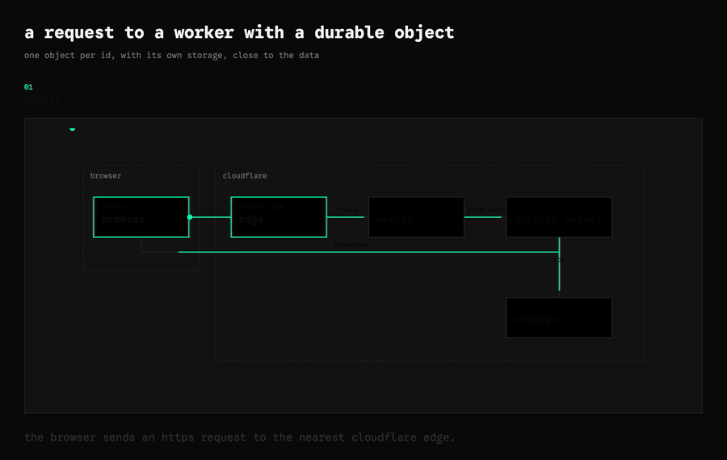
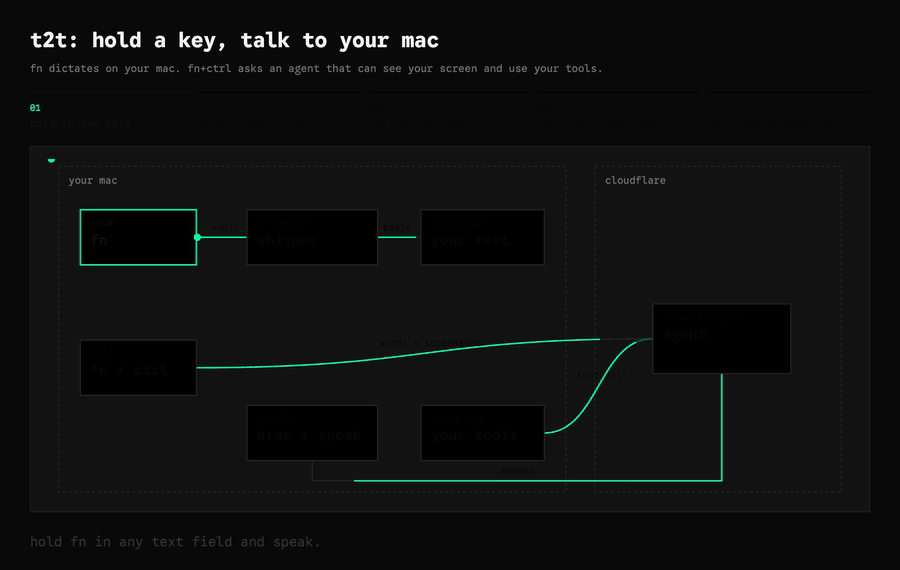

# t2t


**Hold `fn` to dictate. Hold `fn` + `ctrl` to ask an agent that sees your screen, uses your tools, and draws its answers.**

[](web/static/demos/durable-object-request.mp4)

> “Show me how a request to a Worker with a Durable Object works, and record it.”
> The agent built this diagram and saved the video in 19 seconds, for $0.20. Unedited.

## What it does

| | |
| --- | --- |
| **Dictate** | Hold `fn` in any text field and speak. Whisper transcribes on your Mac and the text lands at your cursor. A slider sets how long a pause must be before each phrase is pasted. |
| **Ask** | Hold `fn` + `ctrl`. Your words and a screenshot go to an agent (Claude Opus 5.5 in a Cloudflare Durable Object). Replies stream in and are spoken aloud. |
| **Explain with scenes** | Ask how something works. The agent writes a short scene — boxes, wires, steps — and t2t's scene kit turns it into an animated diagram in a window on your Mac. |
| **Any UI** | For charts, tables, forms or 3D, the agent writes HTML into a window. Windows are normal Mac windows and come back after a restart. |
| **Record it** | Say "record it". t2t renders one loop offscreen, frame by frame, to a 30 fps mp4 in `~/Movies/t2t`. Your screen, mouse and focus are never touched. |
| **Point and draw** | The agent draws boxes, arrows and labels over your apps to show you where things are. |
| **Use your tools** | t2t uses the MCP servers in `~/.pi/agent/mcp.json`. Tools run on your Mac. Optional Allow / Deny before each call. |
| **Use your apps** | With the [hand](https://github.com/acoyfellow/hand) MCP server, the agent reads and changes Mac apps through Accessibility, without stealing focus. |
| **Mute while talking** | Your Mac's sound mutes while you hold the key, and comes back when you let go. |

## How it works

[](web/static/demos/how-t2t-works.mp4)

| On your Mac | On Cloudflare |
| --- | --- |
| Swift shell: hotkeys, microphone, paste, overlay, windows, recorder | The agent (pi-durable in a Durable Object) and its conversation |
| Whisper (`whisper-cli`) for dictation | Model calls |
| MCP host for your tools, including hand | Screenshots you send with a question |

Dictation never leaves your Mac. Agent questions do.

## Install

### Bundle (fastest)

Download `t2t-v2.zip` from [GitHub Releases](https://github.com/acoyfellow/t2t/releases), unzip, and run:

```sh
./scripts/install-bundle.sh
```

That starts the UI on `:5197` (static files, no vite), points the MCP host at the bundled bridge, downloads the Whisper model, and opens the app. Dictation works immediately. The bundle is ad-hoc signed, so macOS may ask you to approve it once; `install-bundle.sh` clears the quarantine flag for you.

Agent mode in the bundle needs either your own Worker deploy from source (below) or a maintainer key from the repo owner. The Worker URL and gateway token are configured in Settings.

### From source

Requirements: macOS 15+, Swift 6 (Xcode Command Line Tools), Node 22, `brew install whisper-cpp`, and a Cloudflare account with Workers AI and an AI Gateway.

```sh
git clone https://github.com/acoyfellow/t2t
cd t2t && git checkout v2 && cd v2
./scripts/install.sh --check   # reports what is missing, changes nothing
./scripts/install.sh           # downloads the Whisper model, installs deps, signs the app, starts the UI, opens t2t
```

### One-time setup

`install.sh` creates most of this for you. Three files in `v2/.secrets/` (gitignored, never commit them) are yours to fill in:

| File | What it is |
| --- | --- |
| `key` | Shared secret for the shell, UI, and Worker. `install.sh` generates it. |
| `gateway.url` | Your AI Gateway URL, e.g. `https://gateway.ai.cloudflare.com/v1/<account>/<gateway>/anthropic` |
| `opencode.token` | Your gateway API token |

`install.sh` also creates a local code-signing certificate and keychain in `.secrets/`, so macOS keeps your permissions across rebuilds, and installs a LaunchAgent (`dev.coey.t2t-ui`) that serves the overlay and settings UI on `:5197` at login. Do not run `npm run ui` by hand in a terminal — after a reboot the UI would be dead. Check it with `curl localhost:5197` and read logs at `v2/.tmp/logs/ui.log`.

Once `gateway.url` and `opencode.token` exist, deploy the agent Worker with `./scripts/deploy.sh` (not `npm run deploy`, which skips the profile refresh).

Grant Input Monitoring, Accessibility, Screen Recording and Microphone when macOS asks; Settings → General shows which are missing.

### MCP sign-in

HTTP MCP servers that require sign-in show a **Sign in** button in Settings → Agent tools. Each server's tokens live in `~/Library/Application Support/dev.coey.t2t/mcp-auth/`, readable only by you, and are refreshed automatically. Servers that set an `Authorization` header in `~/.pi/agent/mcp.json` are not affected.

### Troubleshooting

- **Overlay blank after a reboot:** the UI server is not running. `launchctl kickstart -k gui/$(id -u)/dev.coey.t2t-ui`, then `curl localhost:5197`.
- **Permissions lost after a rebuild:** stop t2t, run `tccutil reset Accessibility dev.coey.t2t` (and `Microphone`, `ListenEvent`), reopen the app, and grant again.
- **"Sign in needed" on an MCP server:** open Settings → Agent tools and press Sign in; approve the page that opens in your browser.
- **Verify your install:** `./scripts/verify-install.sh` checks the install script, README, and that no secrets are tracked.

## Scene kit

`v2/kit/scene.js` is one small runtime. A scene is JSON:

```json
{
  "title": "a request to a worker with a durable object",
  "regions": [{ "label": "cloudflare", "x": 220, "y": 10, "w": 700, "h": 330 }],
  "boxes": [{ "id": "worker", "kicker": "fetch handler", "label": "worker", "x": 480, "y": 60, "w": 180, "h": 76 }],
  "wires": [{ "from": "edge", "to": "worker", "label": "route" }],
  "steps": [{ "label": "worker runs", "caption": "the edge runs your worker.", "lit": ["edge", "worker"], "flow": ["edge>worker"] }]
}
```

Render one yourself: `node v2/kit/build.mjs v2/kit/scenes/t2t.json out.html`.

## t2t v1

v1 (the Tauri app, v0.3.x) is deprecated. To remove it:

```sh
launchctl bootout gui/$(id -u)/com.t2t.desktop
rm ~/Library/LaunchAgents/com.t2t.desktop.plist
rm -rf /Applications/t2t.app
```

## License

MIT
